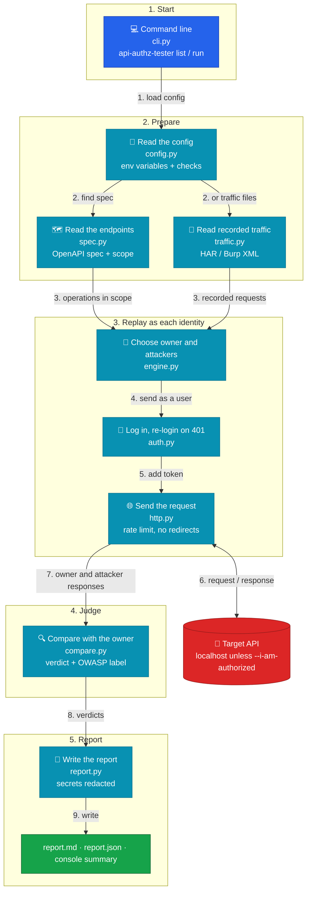

# api-authz-tester

Finds broken authorization in REST APIs by replaying each request as several
users and comparing what comes back.

It targets the two most common API flaws in the
[OWASP API Security Top 10 (2023)](https://owasp.org/API-Security/editions/2023/en/0x11-t10/):

| Check | OWASP | Question it answers |
|---|---|---|
| BOLA | API1:2023 | Can Bob read Alice's object by changing an ID? |
| BFLA | API5:2023 | Can a normal user call an admin-only function? |
| Missing authentication | API2:2023 | Does the endpoint answer with no login at all? |

> **Status:** v0.1. The core engine, CLI and Markdown/JSON reports work. It
> reads endpoints from an OpenAPI spec or from recorded traffic (Burp XML or
> HAR). Everything is tested offline (145 pytest tests) against a small fake vulnerable API in
> [`tests/fake_api.py`](tests/fake_api.py), and in CI against
> [VAmPI](https://github.com/erev0s/VAmPI), a real vulnerable API, in both its
> vulnerable and secure mode ([results](#results-on-vampi),
> [workflow runs](https://github.com/Abulkalam1524/api-authz-tester/actions/workflows/vampi.yml)).
> Findings are not yet confirmed by hand. See [Roadmap](#roadmap).

## How it works

1. Read the API's **OpenAPI spec**, or **recorded traffic** from Burp Suite or the
   browser, to get every request in scope.
2. Log in as each **identity** in the config (for example alice, bob, admin, anonymous).
3. For each endpoint, send the request as the identity that **owns** the object.
   This is the baseline.
4. Replay the same request as every **lower- or equal-privilege** identity.
5. Compare each response with the baseline and give a verdict:

| Verdict | Meaning |
|---|---|
| `ENFORCED` | Blocked (401 / 403 / redirect / 404) |
| `BYPASSED` | Got the same data as the owner: **likely vulnerability** |
| `REVIEW` | Got a 2xx but different data: check by hand |
| `ERROR` | 5xx or network error |
| `SKIPPED` | Baseline failed or required values missing |

`BYPASSED` results are **candidates**. Confirm every one manually before
reporting it. The tool narrows the search; it does not replace the tester.

## Architecture

Each file in `src/api_authz_tester/` has one job. The numbers show the order
of one run.



| File | Job |
|---|---|
| `cli.py` | Reads the command, applies the safety checks, starts everything, sets the exit code |
| `config.py` | Loads the YAML config, fills `${VAR}` from the environment, checks every field |
| `spec.py` | Reads the OpenAPI spec and keeps the endpoints in scope |
| `traffic.py` | Reads recorded traffic (HAR, Burp XML), drops the recorded auth, keeps requests in scope |
| `engine.py` | Picks the owner and the attackers for each request and collects the results |
| `auth.py` | Logs in once per identity, keeps the token, logs in again once on a 401 |
| `http.py` | Sends requests: one session per identity, rate limit, timeout, no redirects |
| `compare.py` | Compares owner and attacker responses and gives the verdict and OWASP label |
| `report.py` | Writes the Markdown and JSON reports and redacts secrets |

Design choices:

- **Small modules, one job each.** Every part can be tested on its own.
- **Safe by default.** Read-only methods, localhost only, rate-limited, secrets redacted.
- **No hidden bugs from expired tokens.** A 401 triggers one re-login and retry, so
  an expired token is not reported as `ENFORCED`.
- **Recorded auth is never replayed.** Tokens and cookies in recorded traffic are
  dropped; every request is sent with the identities from the config.
- **Offline tests.** 145 pytest tests run against a fake vulnerable API on
  `127.0.0.1`, including an end-to-end check of every verdict.
- **Real-app check in CI.** A second workflow runs the tool against VAmPI and
  checks every verdict against a file of expected results.

## Safety

- Only test systems you own or are **authorized** to test.
- Only `GET`, `HEAD` and `OPTIONS` are sent by default. Methods that change
  state need `--allow-unsafe`.
- Requests are rate-limited (5 per second by default).
- Any host other than `localhost` needs `--i-am-authorized`.
- Tokens, cookies and API keys are redacted in every report.
- Passwords and tokens go in environment variables (`${VAR}`), never in config files.

## Usage

```bash
pip install -e ".[dev]"
api-authz-tester list -c my.config.yml       # show what would be tested (sends no API requests)
api-authz-tester run  -c my.config.yml -o reports/run.md --json reports/run.json
```

`run` options:

| Option | Meaning |
|---|---|
| `-o FILE` | write the Markdown report |
| `--json FILE` | write the JSON report |
| `--allow-unsafe` | also send POST/PUT/PATCH/DELETE (spec: only with a JSON example body; traffic: the recorded body) |
| `--rate N` | max requests per second (overrides `rate_limit`) |
| `--i-am-authorized` | needed when `base_url` is not `localhost` / `127.0.0.1` / `::1` |

Exit codes: `0` no BYPASSED, `1` at least one BYPASSED, `2` config or usage error.

See [`examples/vampi.config.yml`](examples/vampi.config.yml) for a full config.
In short: `target` (URL, OpenAPI spec file or URL, rate limit, timeout,
similarity threshold), `traffic` (recorded files and who recorded them, see
below), `scope` (`include` / `exclude` / `public` path globs and
`methods`), and `identities` (name, privilege, `login` or `headers`, and `owns`:
the parameter values that belong to that identity). `${VAR}` is read from the
environment.

Good to know:

- Each identity logs in on first use. If a request gets 401, it logs in again
  once and retries, so an expired token does not hide a bug.
- Paths in `scope.public` are not replayed at all (if anonymous may read them,
  everyone may).
- An endpoint with no parameters (like `/admin/stats`) uses the
  highest-privilege identity as the owner.
- Only token login (token read from a JSON response) is supported for now.

### Use recorded traffic (Burp Suite or HAR)

No OpenAPI spec? Record the app while you use it as one user, then let the tool
replay every request as the other users, like Burp's Autorize extension.

1. Record, logged in as one identity (for example alice):
   - **Burp Suite:** select the requests in Proxy > HTTP history, right-click,
     **Save items**, keep "Base64-encode requests and responses" on. This gives an XML file.
   - **Browser:** DevTools > Network > right-click > **Save all as HAR**.
2. Say who recorded each file. `spec` is optional when `traffic` is given; with
   both, both are tested.

   ```yaml
   traffic:
     - file: traffic/alice.har    # relative to the config file
       owner: alice
     - file: traffic/admin.xml
       owner: admin               # format comes from .har / .xml, or set format: har|burp
   ```

3. `api-authz-tester list -c my.config.yml` shows what will be replayed and
   what was skipped (other hosts, static files like `.js` and `.png`,
   out-of-scope paths, duplicates).

Each recorded request is sent again as its owner (a fresh baseline; the
recorded response is not used) and then as every identity with lower or equal
privilege. Only requests to `target.base_url` are sent.

> **Recorded files contain real tokens, cookies and passwords.** The tool never
> sends the recorded `Authorization`, `Cookie` or identity headers, and reports
> redact secrets (also in form bodies like `password=...`). Keep recordings in
> `traffic/` or name them `*.har`: both are gitignored. The XML is read with
> Python's standard parser, so only import Burp files you saved yourself.

### Try it on VAmPI

```bash
docker run -d -p 5000:5000 -e vulnerable=1 erev0s/vampi:latest   # or vulnerable=0
export VAMPI_USER1_PASS=pass1 VAMPI_USER2_PASS=pass2 VAMPI_ADMIN_PASS=pass1   # VAmPI's public demo passwords
python ci/vampi/setup_vampi.py http://localhost:5000      # reset the database, add one book per user
api-authz-tester run -c examples/vampi.config.yml -o reports/vampi.md
```

See [Results on VAmPI](#results-on-vampi) for what to expect.

### Try it on the fake API

```bash
python tests/fake_api.py --port 8000 &
export FAKE_API_URL=http://127.0.0.1:8000
export FAKE_ALICE_PASS=alice-pass FAKE_BOB_PASS=bob-pass FAKE_ADMIN_PASS=admin-pass
api-authz-tester run -c tests/fixtures/fake_api_config.yml -o reports/fake.md
```

Sample report excerpt from that run:

```markdown
| Verdict | Count |
|---|---|
| ENFORCED | 11 |
| BYPASSED | 7 |
| REVIEW | 2 |
| ERROR | 0 |
| SKIPPED | 1 |

## Matrix

| Request | alice | bob | admin | anonymous |
|---|---|---|---|---|
| `GET /users/alice` | owner (200) | ENFORCED (403) | - | ENFORCED (401) |
| `GET /notes/1` | owner (200) | BYPASSED (200) | - | ENFORCED (401) |
| `GET /admin/stats` | BYPASSED (200) | BYPASSED (200) | owner (200) | ENFORCED (401) |
| `GET /debug/config` | BYPASSED (200) | BYPASSED (200) | owner (200) | BYPASSED (200) |
| `GET /me` | REVIEW (200) | REVIEW (200) | owner (200) | ENFORCED (401) |

### 1. BOLA (API1:2023): `GET /notes/1`

- **Endpoint:** `GET /notes/{note_id}`
- **Owner:** alice (privilege 1), status 200
- **Attacker:** bob (privilege 1), status 200
- **Similarity:** 1.00
- **Attacker response (excerpt):** `{"id": 1, "owner": "alice", "text": "Alice's private note: the vault code is 1234."}`

    curl -i -X GET http://127.0.0.1:8000/notes/1 -H 'Authorization: Bearer <bob-token>'

Candidate: confirm manually before reporting.
```

(Matrix rows shortened. `-` means not tested: higher privilege reading lower
data is expected.) Secrets in responses are redacted, for example
`/debug/config` shows `"db_password": "[REDACTED]"`.

### Try it on the fake API with recorded traffic

The fixtures `tests/fixtures/alice.har` and `tests/fixtures/admin.xml` were
"recorded" on port 8000 with fake tokens:

```bash
python tests/fake_api.py --port 8000 &
export FAKE_API_URL=http://127.0.0.1:8000
export FAKE_ALICE_PASS=alice-pass FAKE_BOB_PASS=bob-pass FAKE_ADMIN_PASS=admin-pass
api-authz-tester run -c tests/fixtures/fake_traffic_config.yml -o reports/traffic.md
```

## Results on VAmPI

[VAmPI](https://github.com/erev0s/VAmPI) can run with its bugs on
(`vulnerable=1`) or off (`vulnerable=0`). CI runs the tool against both, with
[`examples/vampi.config.yml`](examples/vampi.config.yml), and fails if any
verdict changes.

| Request | Attacker | vulnerable=1 | vulnerable=0 |
|---|---|---|---|
| `GET /books/v1/alice-secret-book` | bob | **BYPASSED (BOLA)** | ENFORCED (404) |
| `GET /books/v1/bob-secret-book` | alice | **BYPASSED (BOLA)** | ENFORCED (404) |
| `GET /users/v1/_debug` | alice, bob | **BYPASSED (BFLA)** | **BYPASSED (BFLA)** |
| `GET /users/v1/_debug` | anonymous | **BYPASSED (Missing auth)** | **BYPASSED (Missing auth)** |
| `GET /me` | alice, bob | REVIEW | REVIEW |
| `GET /books/v1/...`, `GET /me` | anonymous | ENFORCED (401) | ENFORCED (401) |

- The book BOLA is found when VAmPI is vulnerable and is `ENFORCED` when it is
  fixed. `/users/v1/_debug` leaks every password and stays open even in
  VAmPI's secure mode, so `BYPASSED` in both columns is correct.
- In the vulnerable run, tokens expire every 5 seconds during the scan. The
  tool logs in again on 401, and the results do not change.
- `GET /users/v1`, `GET /books/v1` and `GET /users/v1/{username}` are public by
  design, so they are listed in `scope.public`. Without that list the tool
  reports 13 false positives on them.

Details, curl commands and known limitations: [docs/vampi-results.md](docs/vampi-results.md).

## Roadmap

- [x] **Session 1:** core engine, CLI, Markdown/JSON reports, offline test suite ([brief](docs/briefs/session-1-core.md))
- [x] **Session 2:** CI that runs the tool against [VAmPI](https://github.com/erev0s/VAmPI) in vulnerable and secure mode ([brief](docs/briefs/session-2-vampi-ci.md))
- [x] **Session 3:** import requests from Burp Suite XML and HAR files ([brief](docs/briefs/session-3-traffic-import.md))
- [ ] Manual OWASP API Top 10 assessment of [crAPI](https://github.com/OWASP/crAPI), with tool results validated by hand

## License

MIT
