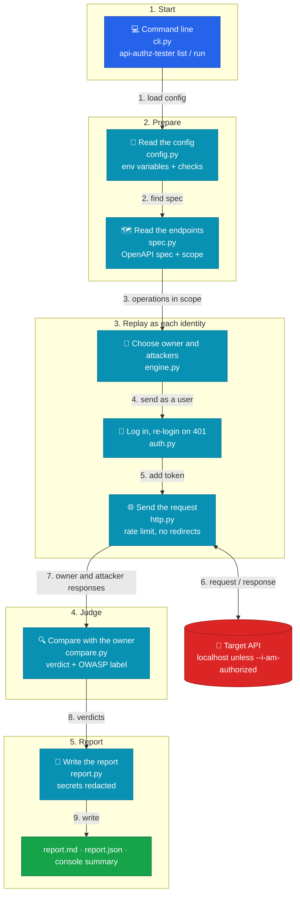

# api-authz-tester

Finds broken authorization in REST APIs by replaying each request as several
users and comparing what comes back.

It targets the two most common API flaws in the
[OWASP API Security Top 10 (2023)](https://owasp.org/API-Security/editions/2023/en/0x11-t10/):

| Check | OWASP | Question it answers |
|---|---|---|
| BOLA | API1:2023 | Can Bob read Alice's object by changing an ID? |
| BFLA | API5:2023 | Can a normal user call an admin-only function? |
| Missing authentication | API2:2023 | Does the endpoint answer with no login at all? |

> **Status:** v0.1. The core engine, CLI and Markdown/JSON reports work. They
> are tested offline (99 pytest tests) against a small fake vulnerable API in
> [`tests/fake_api.py`](tests/fake_api.py). The tool has **not** yet been run in
> CI against a real vulnerable app such as VAmPI; that is the next step. See
> [Roadmap](#roadmap).

## How it works

1. Read the API's **OpenAPI spec** to get every endpoint in scope.
2. Log in as each **identity** in the config (for example alice, bob, admin, anonymous).
3. For each endpoint, send the request as the identity that **owns** the object.
   This is the baseline.
4. Replay the same request as every **lower- or equal-privilege** identity.
5. Compare each response with the baseline and give a verdict:

| Verdict | Meaning |
|---|---|
| `ENFORCED` | Blocked (401 / 403 / redirect / 404) |
| `BYPASSED` | Got the same data as the owner: **likely vulnerability** |
| `REVIEW` | Got a 2xx but different data: check by hand |
| `ERROR` | 5xx or network error |
| `SKIPPED` | Baseline failed or required values missing |

`BYPASSED` results are **candidates**. Confirm every one manually before
reporting it. The tool narrows the search; it does not replace the tester.

## Architecture

Each file in `src/api_authz_tester/` has one job. The numbers show the order
of one run.



| File | Job |
|---|---|
| `cli.py` | Reads the command, applies the safety checks, starts everything, sets the exit code |
| `config.py` | Loads the YAML config, fills `${VAR}` from the environment, checks every field |
| `spec.py` | Reads the OpenAPI spec and keeps the endpoints in scope |
| `engine.py` | Picks the owner and the attackers for each request and collects the results |
| `auth.py` | Logs in once per identity, keeps the token, logs in again once on a 401 |
| `http.py` | Sends requests: one session per identity, rate limit, timeout, no redirects |
| `compare.py` | Compares owner and attacker responses and gives the verdict and OWASP label |
| `report.py` | Writes the Markdown and JSON reports and redacts secrets |

Design choices:

- **Small modules, one job each.** Every part can be tested on its own.
- **Safe by default.** Read-only methods, localhost only, rate-limited, secrets redacted.
- **No hidden bugs from expired tokens.** A 401 triggers one re-login and retry, so
  an expired token is not reported as `ENFORCED`.
- **Offline tests.** 99 pytest tests run against a fake vulnerable API on
  `127.0.0.1`, including an end-to-end check of every verdict.

## Safety

- Only test systems you own or are **authorized** to test.
- Only `GET`, `HEAD` and `OPTIONS` are sent by default. Methods that change
  state need `--allow-unsafe`.
- Requests are rate-limited (5 per second by default).
- Any host other than `localhost` needs `--i-am-authorized`.
- Tokens, cookies and API keys are redacted in every report.
- Passwords and tokens go in environment variables (`${VAR}`), never in config files.

## Usage

```bash
pip install -e ".[dev]"
api-authz-tester list -c my.config.yml       # show what would be tested (sends no API requests)
api-authz-tester run  -c my.config.yml -o reports/run.md --json reports/run.json
```

`run` options:

| Option | Meaning |
|---|---|
| `-o FILE` | write the Markdown report |
| `--json FILE` | write the JSON report |
| `--allow-unsafe` | also send POST/PUT/PATCH/DELETE (only if the spec has a JSON example body) |
| `--rate N` | max requests per second (overrides `rate_limit`) |
| `--i-am-authorized` | needed when `base_url` is not `localhost` / `127.0.0.1` / `::1` |

Exit codes: `0` no BYPASSED, `1` at least one BYPASSED, `2` config or usage error.

See [`examples/vampi.config.yml`](examples/vampi.config.yml) for a full config.
In short: `target` (URL, OpenAPI spec file or URL, rate limit, timeout,
similarity threshold), `scope` (`include` / `exclude` / `public` path globs and
`methods`), and `identities` (name, privilege, `login` or `headers`, and `owns`:
the parameter values that belong to that identity). `${VAR}` is read from the
environment.

Good to know:

- Each identity logs in on first use. If a request gets 401, it logs in again
  once and retries, so an expired token does not hide a bug.
- Paths in `scope.public` are not replayed at all (if anonymous may read them,
  everyone may).
- An endpoint with no parameters (like `/admin/stats`) uses the
  highest-privilege identity as the owner.
- Only token login (token read from a JSON response) is supported for now.

### Try it on the fake API

```bash
python tests/fake_api.py --port 8000 &
export FAKE_API_URL=http://127.0.0.1:8000
export FAKE_ALICE_PASS=alice-pass FAKE_BOB_PASS=bob-pass FAKE_ADMIN_PASS=admin-pass
api-authz-tester run -c tests/fixtures/fake_api_config.yml -o reports/fake.md
```

Sample report excerpt from that run:

```markdown
| Verdict | Count |
|---|---|
| ENFORCED | 11 |
| BYPASSED | 7 |
| REVIEW | 2 |
| ERROR | 0 |
| SKIPPED | 1 |

## Matrix

| Request | alice | bob | admin | anonymous |
|---|---|---|---|---|
| `GET /users/alice` | owner (200) | ENFORCED (403) | - | ENFORCED (401) |
| `GET /notes/1` | owner (200) | BYPASSED (200) | - | ENFORCED (401) |
| `GET /admin/stats` | BYPASSED (200) | BYPASSED (200) | owner (200) | ENFORCED (401) |
| `GET /debug/config` | BYPASSED (200) | BYPASSED (200) | owner (200) | BYPASSED (200) |
| `GET /me` | REVIEW (200) | REVIEW (200) | owner (200) | ENFORCED (401) |

### 1. BOLA (API1:2023): `GET /notes/1`

- **Endpoint:** `GET /notes/{note_id}`
- **Owner:** alice (privilege 1), status 200
- **Attacker:** bob (privilege 1), status 200
- **Similarity:** 1.00
- **Attacker response (excerpt):** `{"id": 1, "owner": "alice", "text": "Alice's private note: the vault code is 1234."}`

    curl -i -X GET http://127.0.0.1:8000/notes/1 -H 'Authorization: Bearer <bob-token>'

Candidate: confirm manually before reporting.
```

(Matrix rows shortened. `-` means not tested: higher privilege reading lower
data is expected.) Secrets in responses are redacted, for example
`/debug/config` shows `"db_password": "[REDACTED]"`.

## Roadmap

- [x] **Session 1:** core engine, CLI, Markdown/JSON reports, offline test suite ([brief](docs/briefs/session-1-core.md))
- [ ] **Session 2:** CI that runs the tool against [VAmPI](https://github.com/erev0s/VAmPI)
- [ ] **Session 3:** import requests from Burp Suite XML and HAR files
- [ ] Manual OWASP API Top 10 assessment of [crAPI](https://github.com/OWASP/crAPI), with tool results validated by hand

## License

MIT
